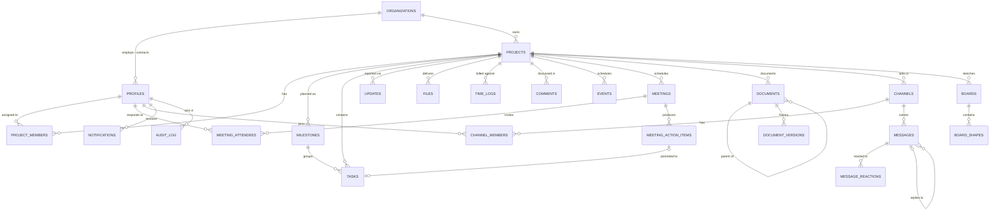
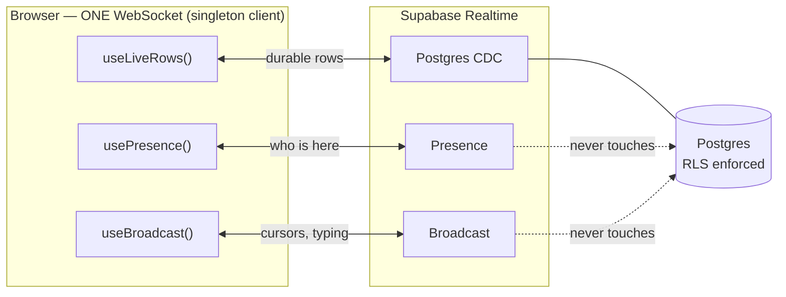
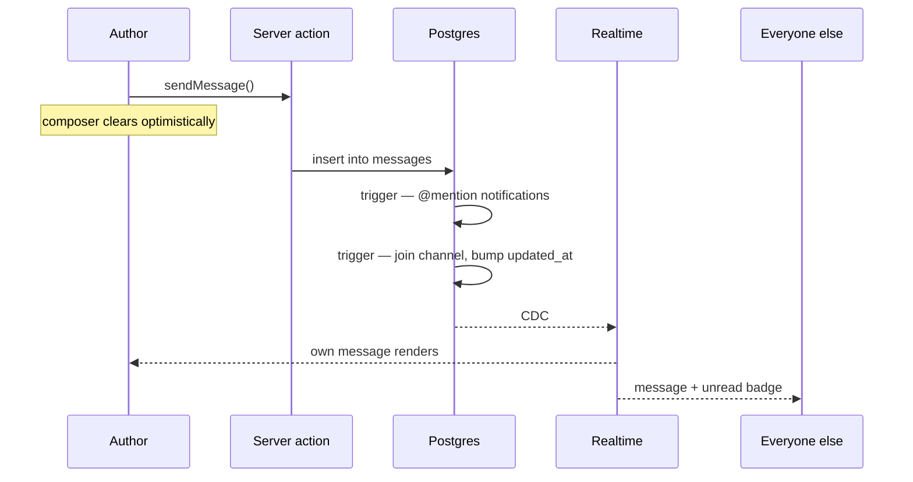

# Workspace architecture

Schema, security model, realtime topology and deployment for the collaboration
surface at `/workspace`. Operational setup lives in [WORKSPACE.md](../WORKSPACE.md);
this is the "how does it actually work" document.

Two migrations, applied in order:

| File | Contains |
| --- | --- |
| `supabase/migrations/0001_workspace.sql` | Projects, milestones, tasks, updates, comments, files, time logs, requests, notifications, audit log |
| `supabase/migrations/0002_collaboration.sql` | Calendar, documents + wiki, meetings, chat, whiteboard, knowledge graph, presence support |

---

## 1. Entity relationships

Organizations are the tenant boundary. Every read rule in the system reduces to
"is this row reachable from the caller's organization, and was it shared".



### The `links` table

`links` is deliberately outside that diagram: it is a **polymorphic** edge
table, so it has no foreign key to either endpoint.

```
links(source_kind, source_id) ──▶ (target_kind, target_id)
```

It stores only edges a human or a trigger asserted — a `[[wiki link]]`, or a
manual "this board relates to that task". Structural edges (a task's milestone,
a document's parent) are **not** duplicated here: they already exist as real
foreign keys, and `knowledge_graph()` unions them in at read time. Storing them
twice would guarantee they eventually disagree.

Because the endpoints have no FK, deletion is handled by an explicit
`prune_links_for()` trigger on each node table, rather than by `ON DELETE
CASCADE`.

### Two design choices worth knowing

**Documents and the wiki are one table.** A `doc` hangs off a project; a `wiki`
page belongs to the workspace. Same tree, same editor, same version history,
same `[[link]]` resolution — the only difference is `kind` and whether
`project_id` is set. Splitting them would have duplicated all of that to encode
one boolean.

**`project_id` is nullable almost everywhere.** A calendar entry, document,
channel or board can be workspace-level. That makes `UNIQUE (project_id, slug)`
useless — Postgres treats every NULL as distinct — so document slugs are scoped
with two partial indexes instead:

```sql
create unique index documents_project_slug_key
  on documents (project_id, slug) where project_id is not null;
create unique index documents_workspace_slug_key
  on documents (slug) where project_id is null;
```

---

## 2. Security model

Multi-tenancy is enforced in Postgres. A bug in a React component cannot leak
Client A's data to Client B, because the database returns zero rows.

### The one rule

Every table added in 0002 reads through a single predicate:

```sql
create function can_see(p_project uuid, p_client_visible boolean)
returns boolean language sql stable security definer as $$
  select is_staff()
      or (coalesce(p_client_visible, false)
          and (p_project is null
               or exists (select 1 from projects
                          where id = p_project
                            and organization_id = current_org_of())));
$$;
```

Staff see everything. A client sees a row only when it was **explicitly shared**
*and* belongs to **their own organization**. Both halves are required: sharing
something in another tenant's project still shows a client nothing.

### Why `SECURITY DEFINER` on the helpers

`can_see`, `is_staff`, `current_org_of`, `can_read_project` and
`is_channel_member` all run as definer. That is not a shortcut — it is what
stops policies re-entering each other.

The clearest case is chat. Written the obvious way:

- the policy on `channels` asks `channel_members` "is this person a member?"
- the policy on `channel_members` asks `channels` "may this person see it?"

Postgres detects the loop and aborts every query on either table with
`infinite recursion detected in policy for relation "channels"`. Reading
membership through a definer function breaks the cycle. Each helper takes only
its arguments and only ever reads the *caller's own* rows, so none of them can
be used as an exfiltration primitive.

### What each role can reach

| Table | Client | Employee | Admin |
| --- | --- | --- | --- |
| `projects` | own org | all | all |
| `tasks` | own org + `client_visible` | all | all |
| `documents` | own org + `client_visible`, not archived | all | all |
| `document_versions` | only for documents they can read | all | all |
| `events` / `meetings` / `boards` / `channels` | own org + `client_visible` | all | all |
| `messages` | only in channels they can see | all | all |
| `board_shapes` | read **and write** on shared boards | all | all |
| `time_logs` | nothing | own rows | all |
| `links` | own project only | all | all |
| `audit_log` | nothing | nothing | read-only |

Three things that are easy to get wrong and are handled explicitly:

- **`document_versions` is not a side channel.** Its read policy is
  `exists (select 1 from documents where id = document_id)` — and `documents`
  is itself under RLS, so history for a page you cannot read returns nothing.
- **A shared whiteboard is collaborative, not read-only.** `board_shapes`
  allows writes to anyone who can open the board. That is the intent; the gate
  is whether the board was shared at all.
- **Version history is written only by a trigger.** `document_versions` has no
  insert policy, so history cannot be forged or back-dated from the client.

### Escalation guards

- `guard_profile_privileges` silently reverts any `role` or `organization_id`
  change made by a non-admin, so "edit your own profile" cannot become "make
  myself an admin".
- `approve_milestone` is the only write path a client has into `milestones`,
  and only moves `done → approved`.
- `workspace_search` and `knowledge_graph` are `SECURITY INVOKER`, so results
  are RLS-filtered per caller.
- `knowledge_graph` drops any edge whose endpoints did not *both* survive RLS —
  a client never sees a line pointing at a node they are not allowed to know
  exists.

All of the above is asserted in `supabase/tests/02_assert.sql`.

---

## 3. Realtime architecture

Supabase Realtime is used three different ways, and picking the wrong one is
the difference between a smooth board and a database on fire.



| Hook | Transport | Carries | Survives reload | Hits the DB |
| --- | --- | --- | --- | --- |
| `useLiveRows` | Postgres CDC | tasks, messages, shapes, docs | yes | yes |
| `usePresence` | Presence | who is on this surface | no | no |
| `useBroadcast` | Broadcast | cursor position, typing | no | **no** |

The rule: **if losing it on refresh would be a bug, it is CDC; otherwise it must
not be a write.** A whiteboard cursor moves ~20×/second per person. As inserts
that is thousands of rows a minute and a bill; as Broadcast it is free and
correctly forgotten the moment the tab closes.

### Details that matter

- **One socket.** `supabaseBrowser()` is a singleton, so a page showing a board,
  its chat and its presence opens one WebSocket, not three.
- **`REPLICA IDENTITY FULL`** is set on `board_shapes` and `messages`. Without
  it an UPDATE payload carries only the primary key, and remote clients cannot
  render the change.
- **Composite keys need `identify`.** A DELETE payload carries only the replica
  identity. `message_reactions` is keyed `(message_id, profile_id, emoji)` and
  has no `id`, so its `useLiveRows` call passes an explicit identity function.
- **Server render wins.** Every `useLiveRows` resets to its `initial` prop when
  that prop changes — a `revalidatePath` after a mutation is authoritative,
  RLS-filtered truth, and beats whatever the socket folded in.
- **`initial` must be referentially stable.** An array literal built during
  render re-triggers the reset effect every render and spins.
- **Ephemeral state expires on a timer.** Typing markers and remote cursors are
  aged out client-side rather than waiting for a "stopped" event, because a
  closed tab never sends one and a stuck "…is typing" is worse than a 2s delay.
- **RLS applies to the stream.** The unread-badge subscription in `ChannelRail`
  listens to `messages` with no filter, which is safe precisely because the
  socket only ever delivers rows the subscriber may read.

### Sending a chat message



`sendMessage` deliberately does **not** call `revalidatePath`. The row returns
over the socket in milliseconds; a router refresh per keystroke-send would make
the thread flicker.

---

## 4. Triggers

| Trigger | On | Does |
| --- | --- | --- |
| `handle_new_user` | `auth.users` insert | Creates the profile, derives a unique `handle`. First account ever becomes admin |
| `on_document_update` | `documents` update | Stamps the editor; snapshots the **previous** body into `document_versions` |
| `sync_document_links` | `documents` insert/update | Parses `[[Page Title]]` into real `links` edges |
| `prune_links_for(kind)` | delete on documents / tasks / meetings / boards | Removes edges pointing at the deleted node |
| `on_message_created` | `messages` insert | Notifies `@handle` mentions and the person replied-to; bumps channel activity |
| `on_message_sent_join` | `messages` insert | Sending joins the channel, so your own messages count as read |
| `on_meeting_invited` | `meeting_attendees` insert | Notifies the invitee (never the organiser) |
| `on_document_shared` | `documents` update | Audits and notifies when a page is first shared with a client |
| `recalc_project_progress` | `milestones` change | Recomputes `projects.progress_pct` |
| `guard_profile_privileges` | `profiles` update | Reverts privilege changes made by non-admins |

Version snapshots capture the row **before** the edit, so version *N* is
literally "what it looked like before edit *N*" — which is what a restore wants.
Whitespace-only and title-only edits do not earn a version.

---

## 5. RPCs

| Function | Security | Returns |
| --- | --- | --- |
| `calendar_feed(from, to, project)` | INVOKER | Events + meetings + milestone dates, unified |
| `knowledge_graph(project)` | INVOKER | `{nodes, edges}` as jsonb |
| `workspace_search(q)` | INVOKER | ⌘K hits across 7 entity kinds |
| `unread_counts()` | INVOKER | Per-channel unread for the caller |
| `mark_channel_read(channel)` | INVOKER | Moves the caller's read cursor |
| `action_item_to_task(item)` | INVOKER | Promotes an action item; idempotent |
| `touch_presence()` | INVOKER | `last_seen_at` heartbeat |
| `can_see`, `is_staff`, `is_channel_member`, … | DEFINER | Policy helpers |

> **`ORDER BY rank` in a UNION.** Both search functions alias the ranking
> expression `as rank` in their *first* branch. In a UNION, `ORDER BY` resolves
> against the output column names of the first SELECT, **not** the
> `RETURNS TABLE` signature. Unaliased, that column is called `ts_rank` and the
> function fails to compile — which silently aborted the tail of 0001 (including
> the storage bucket and its policies) until it was fixed.

---

## 6. Storage

| Bucket | Public | Cap | Key layout |
| --- | --- | --- | --- |
| `project-files` | no | 10 MB | `<project_id>/<uuid>-<filename>` |
| `chat-attachments` | no | 10 MB | `<channel_id>/<uuid>-<filename>` |

Both are private; downloads go through 10-minute signed URLs. The first path
segment is what the storage policy authorizes against, which is why the key
layout is part of the contract rather than a convention.

Nothing deletes objects automatically — a deleted message leaves its
attachment behind. The `storage-janitor` Edge Function sweeps unreferenced
objects older than 24 hours. The grace window exists because an upload lands in
Storage *before* its row is inserted; a janitor without one would race that and
eat live uploads.

---

## 7. Edge Functions

| Function | Cadence | Why not Vercel |
| --- | --- | --- |
| `meeting-reminders` | every 5 min | Vercel Hobby allows 2 cron runs **per day** |
| `storage-janitor` | weekly | Needs the service-role key and a long timeout |

The daily digest stays on Vercel (`/api/cron/digest`) because once a day is
exactly what Hobby provides.

Both functions run with the service-role key — which is why the `CRON_SECRET`
bearer check is not optional. `meeting-reminders` is idempotent without a state
column: the notification row *is* the record, so a re-run inside the same window
finds it and skips.

```bash
supabase functions deploy meeting-reminders
supabase functions deploy storage-janitor
supabase secrets set CRON_SECRET=… RESEND_API_KEY=… RESEND_FROM=… SITE_URL=…
```

Then schedule them in Dashboard → Database → Cron:

```sql
select cron.schedule('meeting-reminders', '*/5 * * * *', $$
  select net.http_post(
    url     := 'https://<ref>.functions.supabase.co/meeting-reminders',
    headers := jsonb_build_object('Authorization', 'Bearer ' || current_setting('app.cron_secret'))
  );
$$);
```

Type-check them with `cd supabase/functions && deno check */index.ts`. They are
excluded from the root `tsconfig.json` — they import from `jsr:` and use the
`Deno` global, neither of which exists in the Next build.

---

## 8. Testing

```bash
./supabase/tests/run.sh
```

Docker is the only requirement — no Supabase CLI, no local Postgres, no pgTAP.
The script spins up `postgres:16-alpine`, applies a harness that stands in for
Supabase's `auth`/`storage` schemas, applies both migrations, **applies them
again** to prove idempotency, seeds two organizations, and runs 51 assertions.

The isolation tests run as the `authenticated` role with a JWT claim set. That
is the only thing that makes them meaningful: as the table owner RLS is
bypassed, and every check would pass for the wrong reason.

| Section | Covers |
| --- | --- |
| 1 | Triggers — wiki links, version snapshots, mention notifications, handles |
| 2 | RPCs compile and return; `action_item_to_task` is idempotent |
| 3 | Tenant isolation — 18 checks that Org A's client sees nothing of Org B |
| 4 | Privilege escalation — self-promotion, cross-tenant writes |
| 5 | Permitted client writes — posting, drawing on a shared board |
| 6 | Employee scope — staff breadth, audit log still admin-only |

This suite has already earned its keep: it caught the policy recursion between
`channels` and `channel_members`, the `ORDER BY rank` compile failure in 0001,
and a 0001-after-0002 re-run that aborted on a changed function signature.

### Still manual

- Realtime, presence and broadcast — needs two live browsers.
- Storage policies — the harness stubs `storage.objects` rather than
  reproducing Supabase's implementation.
- The end-to-end auth flow.

The check worth doing by hand before trusting this with a real client: sign in
as a second Google account, have an admin make it a client of Org A, then open
Org B's project slug directly. You should get a 404, not a redirect.

---

## 9. Deployment

1. **Database** — run `0001` then `0002` in the Supabase SQL editor. Both are
   re-runnable. `0002` also enables Realtime on the new tables and creates the
   `chat-attachments` bucket.
2. **Auth** — Google provider, plus redirect URLs for
   `/workspace/auth/callback` on localhost and production.
3. **Env** — see the table in [WORKSPACE.md](../WORKSPACE.md#23-environment).
4. **Edge Functions** — deploy and schedule as in §7. Optional; without them
   you lose meeting reminders and orphan cleanup, nothing else.
5. **Vercel** — the daily digest cron is already in `vercel.json`.

### Verify before shipping

```bash
npm run build                                  # typecheck + build
./supabase/tests/run.sh                        # migrations + RLS
cd supabase/functions && deno check */index.ts # edge functions
```

### The one standing risk

Vercel's Hobby plan prohibits commercial use, and a client-facing portal leans
commercial. Two ways out: upgrade to Pro, or deploy to Cloudflare Workers via
OpenNext — nothing here is Vercel-specific except `vercel.json`'s cron, which
becomes a Cloudflare Cron Trigger hitting the same route.
